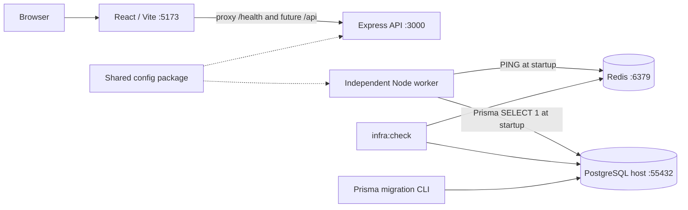

# Architecture after milestone 1

The worker is a process skeleton: it verifies dependencies and stays alive. It does not schedule or execute monitoring jobs yet. The API currently serves liveness and JSON 404 responses; it does not query the database. Vite's proxy is configured but the placeholder page does not issue API requests yet.

Applications run on the host during development. Compose runs only PostgreSQL and Redis, each with a named persistent volume and container health check. Full application containers are planned for day 2.

The shared `@uptime/db` package owns the Prisma schema, migrations, generated client, and client factory. Each process creates its own connection pool; sharing package code does not mean sharing a live network connection. `@uptime/config` loads and validates settings without logging connection strings.

This is one repository with multiple processes, not independently owned microservices. API and worker will share the same domain/database model. Keeping a separate worker allows checks to run even when no browser or API request is active, and allows later concurrency tuning independently of the API.

## Next increments

1. Add Monitor, CheckResult, Incident, NotificationEvent, and session models with database constraints.
2. Add authentication and owner-scoped CRUD to the API.
3. Add safe HTTP execution, BullMQ scheduling, and durable result processing to the worker.
4. Add incident transitions and retryable email events.

The final day-1 flow will be API -> PostgreSQL for configuration, worker -> Redis/BullMQ for scheduled work, worker -> public targets for checks, and worker -> PostgreSQL for results/incidents/events. A durable event dispatcher will deliver alerts through an email adapter.
